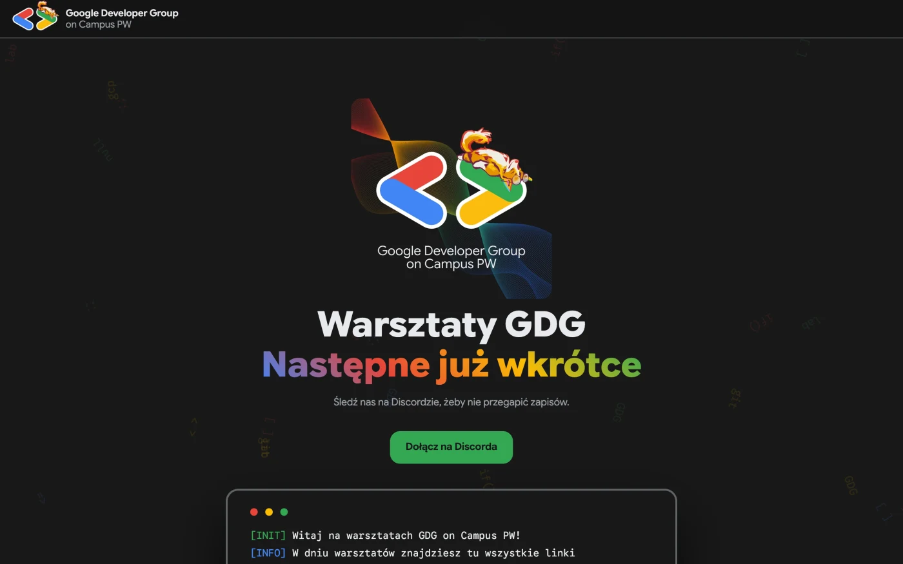
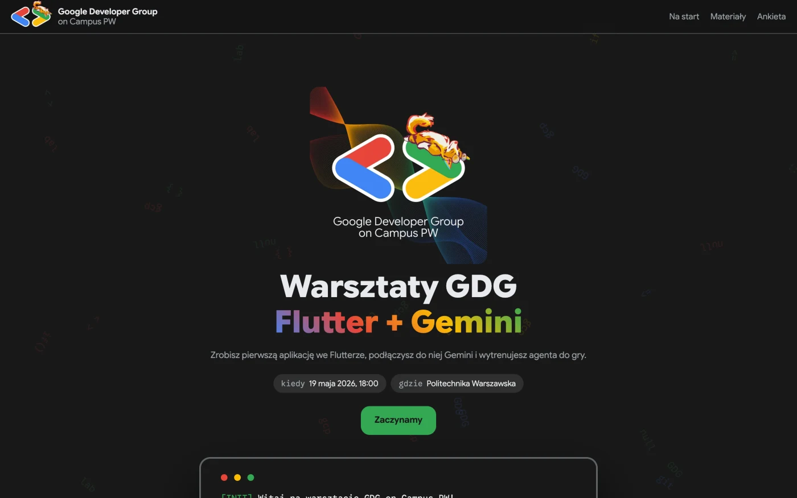
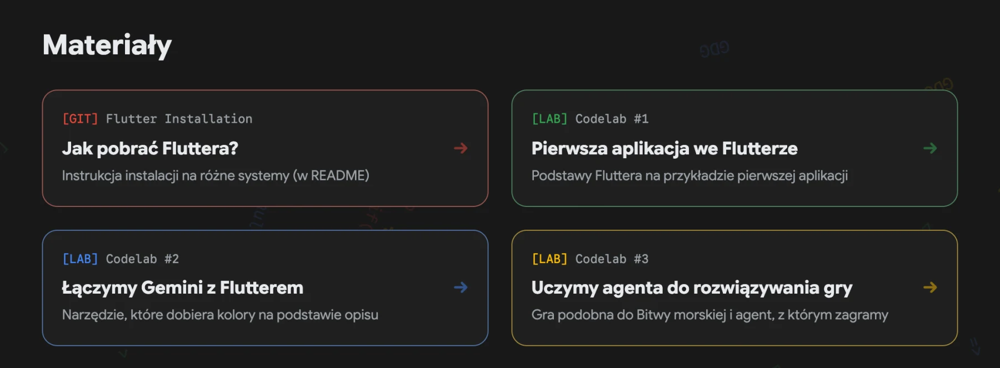
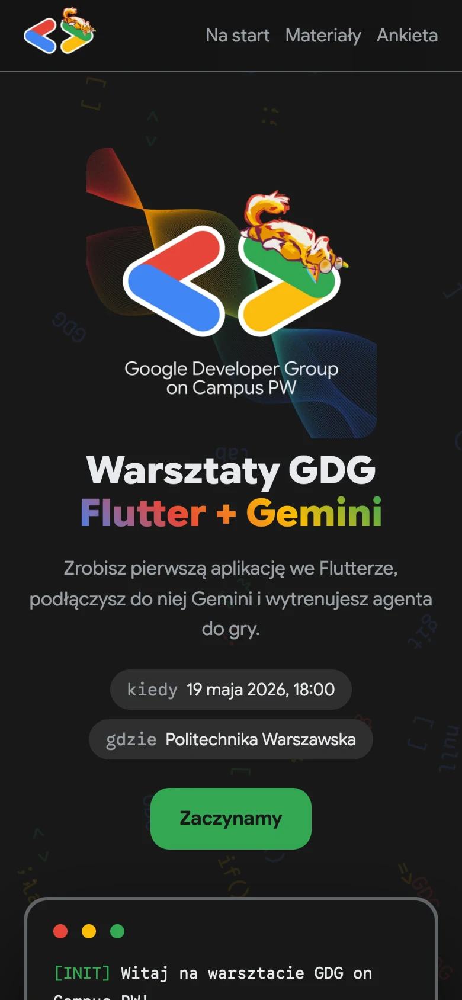
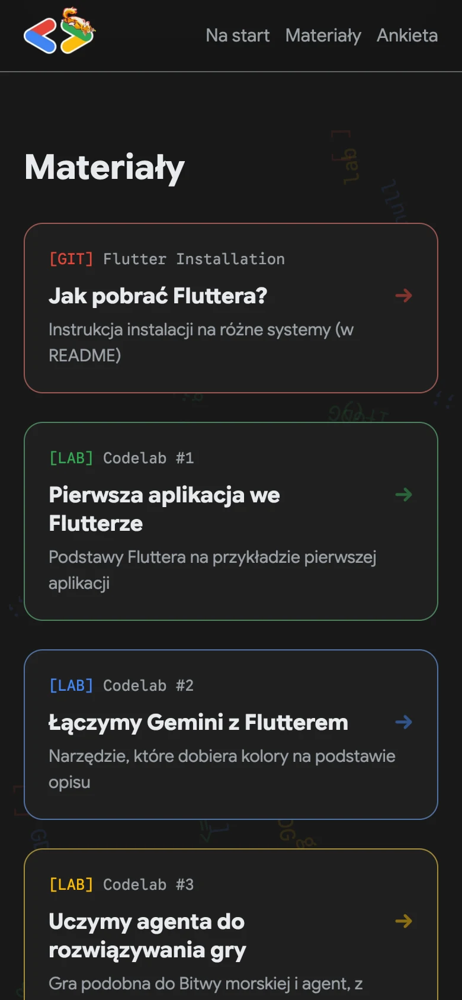

<div align="center">
  

  <h1>Warsztaty GDG</h1>
  <p>Jedna strona na każde warsztaty. Zmieniasz jeden plik, reszta się układa.</p>

  

  <br/><br/>

  
  
  
  
</div>

---

<table>
  <tr>
    <td align="center"><br/><sub>Między warsztatami</sub></td>
    <td align="center"><br/><sub>W dniu warsztatów (dane przykładowe)</sub></td>
  </tr>
</table>

Strona, którą pokazujemy na warsztatach [GDG on Campus PW](https://gdg.community.dev/gdg-on-campus-politechnika-warszawska-warsaw-poland/): temat, kiedy i gdzie, co przygotować, linki do materiałów i ankieta na koniec. Między warsztatami sama przechodzi w tryb „Następne już wkrótce” z linkiem do Discorda.

---

## 🧩 Wszystko z jednego pliku

<div align="center">
  
</div>

Przed warsztatem zmieniasz tylko `js/data.js`. Puste pole chowa swoją sekcję razem z linkiem w menu.

| W `js/data.js` | Na stronie |
|----------------|------------|
| `WORKSHOP` | Temat, opis, kiedy i gdzie |
| `TERMINAL` | Linijki w terminalu pod logo |
| `PREP` | Sekcja „Zanim zaczniemy” |
| `MATERIALS` | Karty z linkami, ramki w kolorach GDG po kolei |
| `SURVEY_URL` | Ankieta na koniec |

Po warsztacie wyczyść pola, a w `TERMINAL` przywróć teksty „wkrótce”.

<details>
<summary><b>Przykład: warsztat Flutter + Gemini</b></summary>

```js
const WORKSHOP = {
  title: "Flutter + Gemini",
  desc:  "Zrobisz pierwszą aplikację we Flutterze, podłączysz do niej Gemini i wytrenujesz agenta do gry.",
  date:  "19 maja 2026, 18:00",
  place: "Politechnika Warszawska",
};

const TERMINAL = [
  ["INIT", "green",  "Witaj na warsztacie GDG on Campus PW!"],
  ["INFO", "blue",   "Poniżej znajdziesz wszystkie potrzebne linki"],
  ["TODO", "yellow", "Zacznij od instalacji Fluttera na swoim urządzeniu ↓"],
];

const PREP = [
  "Weź laptopa z ładowarką.",
  "Zainstaluj Fluttera według <a href=\"https://github.com/gdg-pw/workshop-flutter\" target=\"_blank\" rel=\"noopener\">instrukcji</a>.",
  "Sprawdź instalację: <code>flutter doctor</code>.",
];

const MATERIALS = [
  { tag: "GIT", label: "Flutter Installation", title: "Jak pobrać Fluttera?",               desc: "Instrukcja instalacji na różne systemy (w README)",         url: "https://github.com/gdg-pw/workshop-flutter" },
  { tag: "LAB", label: "Codelab #1",           title: "Pierwsza aplikacja we Flutterze",    desc: "Podstawy Fluttera na przykładzie pierwszej aplikacji",     url: "https://codelabs.developers.google.com/codelabs/flutter-codelab-first?hl=pl#0" },
  { tag: "LAB", label: "Codelab #2",           title: "Łączymy Gemini z Flutterem",         desc: "Narzędzie, które dobiera kolory na podstawie opisu",       url: "https://codelabs.developers.google.com/codelabs/flutter-gemini-colorist?hl=pl#0" },
  { tag: "LAB", label: "Codelab #3",           title: "Uczymy agenta do rozwiązywania gry", desc: "Gra podobna do Bitwy morskiej i agent, z którym zagramy", url: "https://codelabs.developers.google.com/tfagents-flutter/?hl=pl#0" },
];
```

Data i miejsce są przykładowe.

</details>

---

## 📱 Na telefonie

<table>
  <tr>
    <td align="center"></td>
    <td align="center"></td>
  </tr>
</table>

---

## Pod maską

- Czysty HTML, CSS i JS. Bez buildów i zależności. Wygląd jak w [gdg-jam-jar](https://github.com/gdg-pw/gdg-jam-jar).
- Podgląd linku (OG tagi i `assets/og.jpg`) jest ogólny, więc nie trzeba go zmieniać co warsztat.
- Lokalnie: `python3 -m http.server` albo `docker compose up --build` i http://localhost:8098.
- Easter eggi: kliknij logo 5 razy albo wpisz `↑ ↑ ↓ ↓ ← → ← → B A`.

---

<div align="center">
  <sub><a href="https://gdg.community.dev/gdg-on-campus-politechnika-warszawska-warsaw-poland/">GDG on Campus PW</a> &nbsp;·&nbsp; <a href="https://discord.com/invite/vNW4vXVwqH">Discord</a></sub>
</div>
